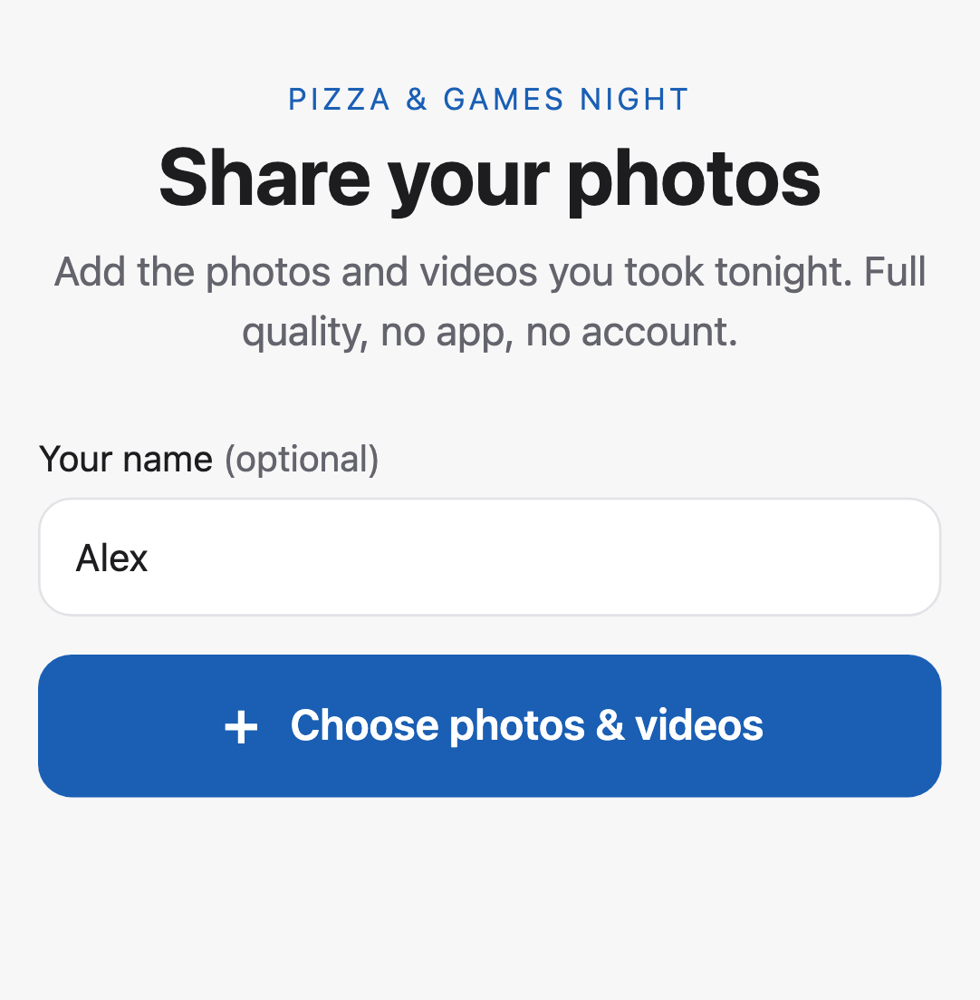
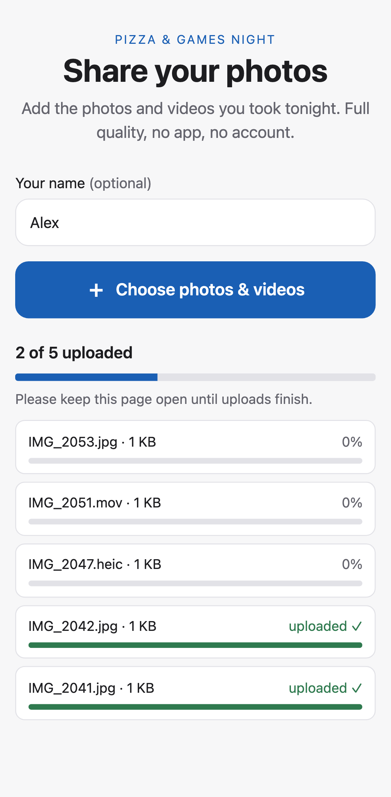
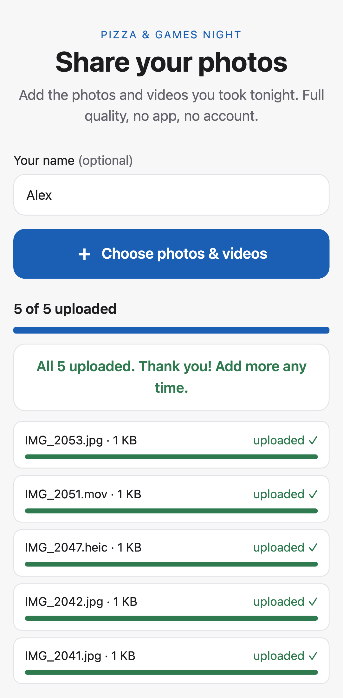
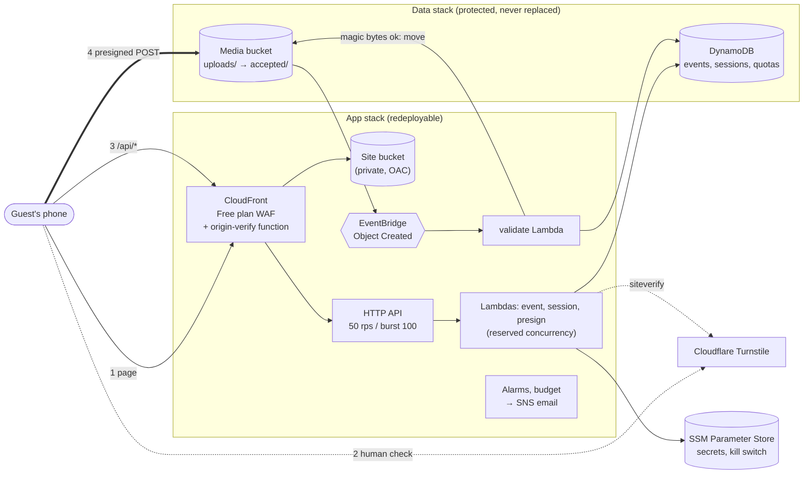

# shotparty

[](https://github.com/billythemoose/shotparty/actions/workflows/ci.yml)

[](LICENSE)

**A self-hosted QR-code photo drop for any event.** Guests scan a card, pick photos and videos on
their phone, and the files land at full quality in an S3 bucket in **your own AWS account**. No
app, no guest accounts, no subscription. A live event costs about $1–$2 a month, and an archived
one well under $1.

<p align="center">
  <picture>
    <source media="(prefers-color-scheme: dark)" srcset="docs/images/guest-open-dark.png" />
    
  </picture>
  &nbsp;
  <picture>
    <source media="(prefers-color-scheme: dark)" srcset="docs/images/guest-uploading-dark.png" />
    
  </picture>
  &nbsp;
  <picture>
    <source media="(prefers-color-scheme: dark)" srcset="docs/images/guest-done-dark.png" />
    
  </picture>
</p>

Built and run for a real event: printed QR cards, guests on venue Wi-Fi and cellular, every photo
downloaded and checksum-verified afterwards. The key decisions, and the evidence behind them, are in
[docs/adr/](docs/adr/README.md).

## Quick start

You need an AWS account you can log in to from the terminal, with a high enough Lambda concurrency
limit (see below), a free Cloudflare account (for the Turnstile bot check), and Node 22, the AWS
CLI, the SAM CLI, cfn-lint, python3 and openssl. Setup checks for the tools and says what's
missing.

1. **Get the code and log in.**
   ```sh
   git clone https://github.com/billythemoose/shotparty.git && cd shotparty && npm ci
   aws sso login --profile <your-profile>          # or any credentials the AWS CLI can use
   export CLOUDFLARE_API_TOKEN=…                   # optional: Account > Turnstile > Edit
   ```
2. **Run setup.** It asks a few questions, saves `shotparty.config.json`, deploys both stacks,
   creates the Turnstile widget and secrets, and creates your first event with its QR code.
   ```sh
   npm run setup
   ```
3. **Confirm and print.** Click the AWS alert email's confirmation link, then print the QR code
   from `qr-codes/`. Optionally subscribe the distribution to the CloudFront Free plan in the
   console (setup names the distribution; there's no API for it) and run setup again to attach
   its WAF.

Any account works once its Lambda concurrency limit is high enough: each stage reserves 205
concurrent executions, and new accounts often start at 10, which makes the deploy fail. Check it
and request an increase as described in
[docs/aws-setup.md](docs/aws-setup.md#account-requirements-both-paths). For a dedicated member
account behind a region-deny SCP, follow the optional hardened path in the same document.

Setup is safe to re-run: it resumes after a failure and changes nothing on a finished install. To
run it unattended, fill in the config yourself (`cp shotparty.config.example.json
shotparty.config.json`) and run `npm run setup -- --config shotparty.config.json`. Without a
Cloudflare token, create the Turnstile widget by hand and enter its keys. Remove a stage with
`npm run teardown -- <stage> [--keep-data]`.

Everything after that (events, the day itself, downloads, the post-event runbook) is in
[docs/operations.md](docs/operations.md).

## Architecture



1. The guest opens the link from the QR code. The page asks the API about the event: its name and
   text, whether it's open, and whether it needs a PIN.
2. **Turnstile** checks the guest is human; the session endpoint verifies that with Cloudflare,
   then checks the kill switch, the event token, the upload window and the PIN, and issues a
   signed 12-hour session.
3. For each file, **presign** re-checks the session and the window, reserves room in three
   quotas, and returns an S3 presigned POST pinned to one key, one content type and the **exact
   byte size**.
4. The phone uploads **straight to S3**: no file bytes pass through Lambda. EventBridge triggers
   `validate`, which reads the first 64 bytes, moves real photos and videos to `accepted/` and
   deletes anything else.

The organizer side is a set of local scripts: create and update events (with QR codes), a private
local gallery, an MD5-verified download, the kill switch, and load and abuse tests.

**How each part works inside**, with diagrams and links into the code, is in
[docs/how-it-works/](docs/how-it-works/README.md): the request flow, abuse protection, sessions,
quotas, the S3 POST policy, validation, the data model, deployment and observability. The
architecture summary is in [docs/ARCHITECTURE.md](docs/ARCHITECTURE.md).

## Cost

Expected for a typical event of about 25 GB of photos and videos:

| Item                                                                                             | Per month                                   |
| ------------------------------------------------------------------------------------------------ | ------------------------------------------- |
| CloudFront Free plan: CDN, TLS, WAF, 1M requests, 100 GB out, 5 GB S3 credit                     | $0                                          |
| S3 Standard storage, 25 GB minus the 5 GB credit                                                 | ~$0.46                                      |
| S3 requests, API Gateway, Lambda, DynamoDB on-demand, EventBridge, SSM                           | pennies                                     |
| Uploads (inbound transfer) and one full download (inside the free 100 GB)                        | $0                                          |
| CloudWatch alarms: 13 alarm metrics per stage, the first 10 per account free                     | ~$0.30 for one stage, ~$1.60 for dev + prod |
| **Total while the event is live**                                                                | **≈ $1–$2**                                 |
| Idle install with no photos: only the alarms                                                     | ~$0.30–$1.60                                |
| After the event: storage with `archiveAfterDays` (S3 Glacier Instant Retrieval), plus the alarms | ~$0.10 + alarms                             |

RAW photos (DNG from iPhone ProRAW or Android, CR2/CR3, NEF, ARW, RAF, ORF, RW2) are 5–10× the size
of a JPEG, so an event where many guests shoot RAW can store a few hundred GB: a few dollars a
month in S3 Standard, cut by about 80% with `archiveAfterDays`. Raise the session limits in the
config's `uploads` section (or per event) for keen photographers.

Deliberately not used: a standalone WAF web ACL ($5+/month), WAF Bot Control ($10+), WAF CAPTCHA
(the $15 Pro plan), Secrets Manager ($0.40 per secret) and a custom domain. A budget alarm emails
at $5 and $15.

## Security

Anyone holding the QR code can reach the upload form, and nothing public is fully bot-proof. So
the goal is to make scripted abuse impractical and to **hard-bound the worst case**, so abuse can
never become a big bill. A request meets these layers in order:

| Layer                                                                           | Stops                                                |
| ------------------------------------------------------------------------------- | ---------------------------------------------------- |
| CloudFront Free plan WAF: IP rate limit + AWS managed rule groups               | Floods and known-bad traffic, at the edge            |
| Origin-verify secret stamped by a CloudFront Function                           | Calling the API directly, around the WAF             |
| 128-bit event token in the link; optional PIN printed beside the QR code        | Scanners and anyone without the card                 |
| Cloudflare Turnstile, verified server-side before every session                 | Scripts, and PIN guessing (each guess costs a check) |
| HMAC-signed 12-hour sessions                                                    | Replaying one human check across many bots           |
| Quotas: per session, per network per hour, per event                            | One guest, one venue or one bot filling the bucket   |
| Presigned POST pinned to key, type and exact size, valid 10 minutes             | Overwrites, odd paths, oversized files, link reuse   |
| Magic-byte validation after upload                                              | Junk and renamed files (`.zip` as `.jpg`)            |
| API throttling and reserved Lambda concurrency                                  | Runaway compute cost                                 |
| Upload window and a kill switch (in effect within 35 s)                         | Late abuse; anything unexpected                      |
| Alarms (errors, throttles, presign spikes, rejects, failed checks) and a budget | Surprises of every kind                              |

The data stays private: the media bucket blocks public access, takes uploads only through
presigned POSTs from the site's origin, and only the organizer's credentials can read it. Client
IPs are stored only as HMACs. With every cap hit at once, the worst case is about $2.30/month of
junk storage until it's deleted. Details and known limits: [SECURITY.md](SECURITY.md).

## Design decisions

Recorded as ADRs in [docs/adr/](docs/adr/README.md):

- **[Two stacks per stage](docs/adr/0001-two-stack-split.md).** The bucket and table live in a
  data stack with retain policies, termination protection and a stack policy that refuses
  replacement; the app stack can be deleted and rebuilt freely. Proven by executing a replacing
  change set, which the policy refused.
- **[CloudFront Free plan for WAF](docs/adr/0002-cloudfront-free-plan-waf.md).** A rate-limiting
  WAF for $0 instead of $5+/month, at the price of a console-only subscription that the scripts
  detect and work around.
- **[No DynamoDB transactions for quotas](docs/adr/0003-no-dynamodb-transactions.md).** The
  first load test failed 16% of presigns with `TransactionConflict` on the shared venue counters.
  Three single-item conditional updates with rollback took it to 300/300.
- **[Magic-byte validation](docs/adr/0004-magic-byte-validation.md).** Uploads go straight to
  S3, so the declared type can't be trusted; a Lambda reads 64 bytes of each file and keeps only
  real photos and videos.
- **[Org hardening as a checklist](docs/adr/0005-org-hardening-docs-only.md).** It deploys
  into any account; isolating it in its own Organization member account is documented, not
  scripted, because that script would need admin rights over a whole Organization.

Other choices: **EventBridge** rather than S3 notifications (no cross-stack cycle), **SSM
parameters** to wire the stacks together (exports would lock them), **one config file** for every
setting with secrets generated straight into SSM, and **arm64 Lambdas** bundled with esbuild.

## Developing

You don't need an AWS account to work on the code:

```sh
npm ci
npm run mock-api                                   # a fake API, in one terminal
API_ORIGIN=http://localhost:8787 npm start         # the guest page, in another
npm run lint && npm run typecheck && npm test      # CI's core checks; it also runs lint:docs,
                                                   # lint:infra, lint:shell, lint:identifiers,
                                                   # the bundle smoke test and test:e2e
npm run test:e2e                                   # Playwright tests of the page (everything mocked)
npm run screenshots                                # redraws the images above
```

| Path       | Purpose                                                                 |
| ---------- | ----------------------------------------------------------------------- |
| `api/`     | Lambda handlers (`src/handlers`) and pure logic (`src/lib`), with tests |
| `web/`     | The guest page (Vite + TypeScript, no framework), unit and `e2e/` tests |
| `infra/`   | SAM templates: `data/`, `app/`, and the optional `org/` SCP             |
| `scripts/` | Setup, deploy, events, gallery, download, load and abuse tests          |
| `docs/`    | How it works, architecture, ADRs, operations, AWS setup, the plan       |

See [CONTRIBUTING.md](CONTRIBUTING.md) for the checks and ground rules, and
[docs/operations.md](docs/operations.md) for deploying and testing against a live stage.

## License

[MIT](LICENSE).
