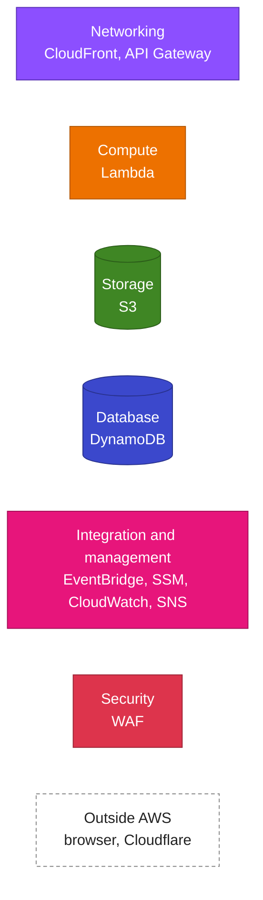

# How shotparty works

These pages explain how each part of shotparty works inside: what happens on a request, which
AWS resources take part, and why it's built that way. They're written for someone reading the code
for the first time. For *running* an install, see [operations.md](../operations.md); for the
decisions in brief, the [ADRs](../adr/README.md).

  <picture>
    <source media="(prefers-color-scheme: dark)" srcset="../diagrams/architecture-dark.svg" />
    
  </picture>

The numbers follow one guest: **1** load the page, **2** pass the human check, **3** call the API
for a session and an upload link per file, **4** send the file straight to S3, **5** the validator
keeps it or deletes it.

## Pages

| Page                                                  | What it covers                                                                       |
| ----------------------------------------------------- | ------------------------------------------------------------------------------------ |
| [Request flow](request-flow.md)                       | One upload end to end, from the QR code to `accepted/`, with every resource it uses  |
| [Abuse protection](abuse-protection.md)               | The layers between the public link and the bucket, and the worst case they allow     |
| [Sessions and the gate](sessions-and-gate.md)         | Event tokens, the window, the kill switch, PINs, Turnstile and the signed session    |
| [Quotas](quotas.md)                                   | The three counters, how a presign reserves and rolls back, and why not a transaction |
| [Presign and the S3 POST policy](presign-and-s3.md)   | What the upload link allows, and what S3 itself enforces                             |
| [Post-upload validation](validation.md)               | Magic bytes, `accepted/` vs. deleted, and duplicate uploads                          |
| [Data model](data-model.md)                           | Every DynamoDB item and S3 prefix, with its key, writer and lifetime                 |
| [Deployment and stacks](deployment.md)                | The data/app split, how the stacks find each other, and the replacement guards       |
| [Observability](observability.md)                     | Logs, metric filters, alarms, email and the budget                                   |

## Reading the code

The API is small and split the same way throughout:

- `api/src/handlers/*.ts`: one file per Lambda. Each handler is a short script of steps that wires
  AWS clients to the logic.
- `api/src/lib/*.ts`: the logic itself, written as plain functions with no AWS calls where
  possible, so it's unit-tested without mocks (`api/test/`). Expected failures are returned as
  `Result` values ([result.ts](../../api/src/lib/result.ts)), not thrown, and each error's `kind`
  is also the `error` code the API sends.
- `infra/data/template.yaml` and `infra/app/template.yaml`: every AWS resource, in SAM/CloudFormation.
- `web/src/`: the guest page (no framework).

Links of the form `file.ts:42` point at the line in this commit. `npm run lint:docs` checks that
every link and line reference in the docs still resolves.

## Diagram conventions

Diagrams are text in the repo, never image-only:

- **Mermaid** inside the Markdown for flows, sequences and data layouts. GitHub renders it in
  light and dark mode.
- **D2** for the architecture overview above, which needs the official AWS icons:
  [docs/diagrams/architecture.d2](../diagrams/architecture.d2), rendered to a light and a dark SVG
  by `npm run diagrams` (needs [d2](https://d2lang.com)).

Mermaid nodes use the AWS Architecture Icons category colors, the same as the icons in the
overview:

Solid fills with white text read the same on GitHub's light and dark backgrounds. Sequence
diagrams keep Mermaid's default theme, which GitHub adapts to the reader's mode.

The AWS icons are from the [AWS Architecture Icons](https://aws.amazon.com/architecture/icons/)
set, used as AWS permits for architecture diagrams.
