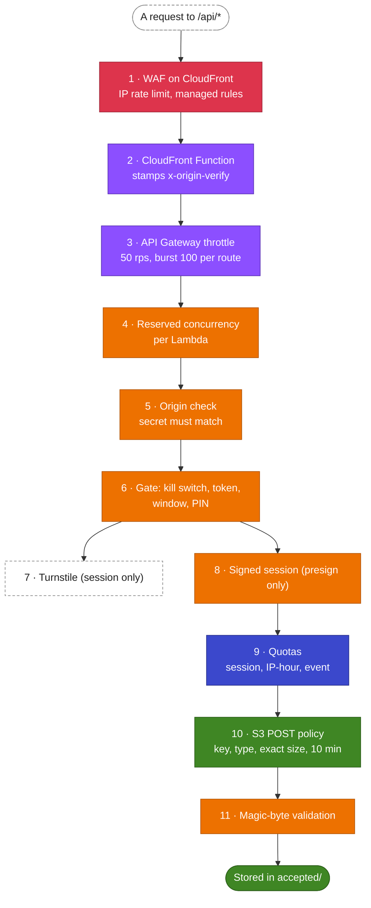

# Abuse protection (defense in depth)

The upload link is printed on cards and handed to a room full of people, so it has to be treated
as public. Nothing public is fully bot-proof. The design goal is narrower and achievable:

1. make scripted abuse **impractical**, and
2. **hard-bound the worst case**, so abuse can only ever cost a few dollars and some cleanup.

No single layer does both. Each one below stops something specific, and each one assumes the layers
before it can fail.

## The layers, in the order a request meets them

| #   | Layer                          | Limits                                                                                 | Where                                                                      |
| --- | ------------------------------ | -------------------------------------------------------------------------------------- | -------------------------------------------------------------------------- |
| 1   | WAF (CloudFront Free plan)     | 3,000 requests per IP per 5 minutes; AWS IP-reputation, Common and Known-bad-inputs rules | Configured in the plan, attached by `WebAclArn` ([template.yaml:403](../../infra/app/template.yaml#L403)) |
| 2   | CloudFront Function            | Adds `x-viewer-ip` and the `x-origin-verify` secret; overwrites what the guest sent     | [template.yaml:378](../../infra/app/template.yaml#L378)                    |
| 3   | API Gateway throttle           | 50 requests per second, burst 100, **per route, for everyone together**               | [template.yaml:94](../../infra/app/template.yaml#L94)                    |
| 4   | Reserved concurrency           | presign 100, validate 50, session 25, event 25, health 5 at once                      | `ReservedConcurrentExecutions` on each function                           |
| 5   | Origin check                   | `403` for any call that didn't come through CloudFront                                 | [origin-guard.ts:12](../../api/src/lib/origin-guard.ts#L12)                |
| 6   | Gate                           | Kill switch, a 128-bit token, the upload window and an optional PIN                   | [gate.ts:30](../../api/src/lib/gate.ts#L30)                                |
| 7   | Turnstile                      | One human check per session; every PIN guess costs one                                 | [turnstile.ts:75](../../api/src/lib/turnstile.ts#L75)                      |
| 8   | Signed session                 | 12 hours; forged or edited tokens fail without a database read                         | [session.ts:43](../../api/src/lib/session.ts#L43)                          |
| 9   | Quotas                         | 500 files / 10 GiB per session, 3,000 files per IP per hour, 20,000 files / 100 GiB per event | [quota.ts:27](../../api/src/lib/quota.ts#L27)                       |
| 10  | S3 POST policy                 | One server-chosen key, one content type, the exact byte size, for 10 minutes          | [upload-policy.ts:125](../../api/src/lib/upload-policy.ts#L125)            |
| 11  | Magic-byte validation          | Only real photos and videos stay; a guest's repeat of the same file is dropped         | [validate-upload.ts:88](../../api/src/lib/validate-upload.ts#L88)          |

Around all of them:

- **Upload window and kill switch.** Each event has an `openFrom`/`openUntil`, and the SSM
  parameter `/<prefix>/<stage>/uploads_enabled` turns every upload off within about 30 seconds.
- **Alarms and a budget** email the organizer about errors, throttling, presign spikes, rejected
  files, quota refusals and failed human checks ([observability](observability.md)).

## How the layers relate

**Edge and compute caps bound the bill for requests.** The WAF stops one address from flooding.
A distributed flood that gets past it meets the API Gateway throttle, which answers `429` without
invoking Lambda, and reserved concurrency caps how many Lambdas can run at once whatever happens.
Together they put a ceiling on the request and compute cost, independent of anything the code does.
The throttle is per route for all guests together, so it's sized for a venue rush (about 150 guests
uploading 3 files at a time), not for one guest. The page retries throttled requests.

**The origin check keeps the edge layers honest.** The HTTP API has a
public `execute-api` URL. Calling it directly would skip the WAF and let a caller invent their own
`x-viewer-ip`, which the per-IP quota relies on. So the CloudFront Function adds a secret, and
every API Lambda except `health` answers `403` unless it matches. The comparison is constant-time, and a
request with no header at all is refused before the secret is even loaded
([client-ip.ts:18](../../api/src/lib/client-ip.ts#L18)).

**The token, PIN and Turnstile decide who gets a session.** The token keeps out anyone who never
saw a card: 128 random bits can't be guessed, and malformed tokens are refused without a database
read. The PIN, printed on the card but not in the QR code, keeps out someone who only saw a photo of
the QR code. Turnstile is checked **before** the PIN, so a script can't try PINs faster than it can
pass human checks.

**The session ties every upload to one human check.** Without it, one Turnstile pass could be
replayed by a thousand bots. With it, the per-session quota means one pass buys at most 500 files.

**Quotas bound the storage.** They're counted at presign time against three scopes, so one guest,
one network and the whole event each have a ceiling. See [quotas](quotas.md).

**The POST policy makes the link single-purpose.** The server picks the key, so a guest can't
overwrite someone else's file or write outside `uploads/`. The size is pinned to exactly what the
quota reserved, so a guest can't reserve 1 byte and send 1 GiB. The link dies after 10 minutes.

**Validation removes what the policy can't see.** The content type is whatever the browser
declared. The validator reads the file's real signature and deletes anything that isn't a photo or
video.

## The worst case

With every cap hit at once, the event counter stops presigns at 20,000 files or 100 GiB. S3 doesn't
charge for inbound data, so filling the cap costs about **$2.30 a month** in S3 Standard storage
until the junk is deleted. Requests and compute are capped by the throttle and concurrency, and
the account budget emails at a third of its limit and at the limit ($20 a month by default).

The realistic risk is nuisance, not cost: someone with a card can upload real but unwanted photos.
The organizer handles that with the gallery, the kill switch and the per-session folders.

## Known limits

- The WAF rate rule was verified by its configuration, not by a real flood, which would have
  blocked the organizer's own address.
- Turnstile proves a human started the session, not that a human is still there. The per-session
  quota bounds what a session can do afterwards.
- Quota counters are approximate under extreme concurrency, always erring toward refusing
  ([quotas](quotas.md#consistency)).
- Validation checks file type, not content: a real photo of anything passes.

More in [SECURITY.md](../../SECURITY.md), and the cost reasoning behind the WAF in
[ADR 0002](../adr/0002-cloudfront-free-plan-waf.md).

## AWS references

- [CloudFront flat-rate pricing plans](https://docs.aws.amazon.com/AmazonCloudFront/latest/DeveloperGuide/flat-rate-pricing-plan.html)
- [AWS WAF rate-based rules](https://docs.aws.amazon.com/waf/latest/developerguide/waf-rule-statement-type-rate-based.html)
- [CloudFront Functions](https://docs.aws.amazon.com/AmazonCloudFront/latest/DeveloperGuide/cloudfront-functions.html)
- [Throttling HTTP API requests](https://docs.aws.amazon.com/apigateway/latest/developerguide/http-api-throttling.html)
- [Lambda reserved concurrency](https://docs.aws.amazon.com/lambda/latest/dg/configuration-concurrency.html)
- [Cloudflare Turnstile server-side validation](https://developers.cloudflare.com/turnstile/get-started/server-side-validation/)
