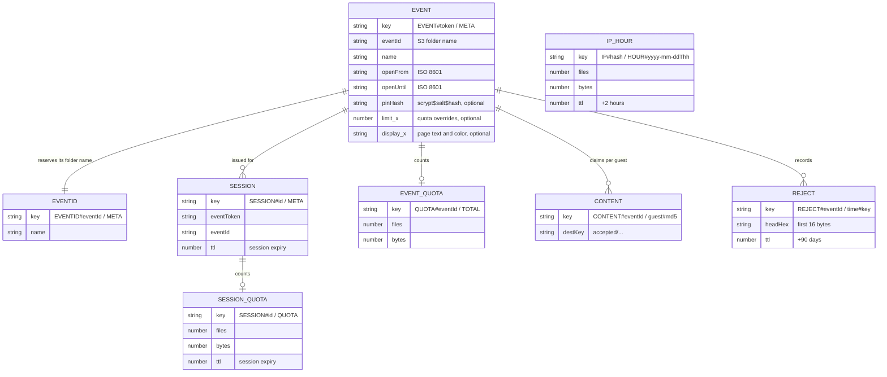

# Data model

All state lives in the **data stack**: one DynamoDB table and one S3 bucket per stage. Secrets
and settings live in SSM Parameter Store.

## The table

One table holds every kind of item (a single-table design). Each item's kind is the prefix of its
partition key.

- Keys: `pk` (partition, string) and `sk` (sort, string). No secondary indexes.
- On-demand billing, so it costs nothing while idle.
- TTL on the `ttl` attribute (epoch seconds), so sessions, counters and rejection records clean
  themselves up.
- Point-in-time recovery, deletion protection and a `Retain` policy
  ([data template.yaml:119](../../infra/data/template.yaml#L119)).

Every read and write on the guest path is a single-item `GetItem`, `PutItem` or `UpdateItem` by
its full key. The only scans are in the organizer's scripts, for example looking an event up by its
folder name ([event-admin.ts:30](../../scripts/lib/event-admin.ts#L30)).

| Item           | `pk` / `sk`                                  | Written by                                       | Read by                       | Lifetime            |
| -------------- | -------------------------------------------- | ------------------------------------------------ | ----------------------------- | ------------------- |
| Event          | `EVENT#<token>` / `META`                     | `event:create`, `event:update`, `event:close`    | event, session, presign       | Until deleted       |
| Event ID       | `EVENTID#<eventId>` / `META`                 | `event:create`                                   | `event:create`                | Until deleted       |
| Session        | `SESSION#<id>` / `META`                      | session Lambda                                   | presign                       | 12 hours (`ttl`)    |
| Session quota  | `SESSION#<id>` / `QUOTA`                     | presign                                          | presign                       | 12 hours (`ttl`)    |
| Event quota    | `QUOTA#<eventId>` / `TOTAL`                  | presign                                          | presign                       | Until deleted       |
| IP-hour quota  | `IP#<hash>` / `HOUR#<yyyy-mm-ddThh>`         | presign                                          | presign                       | 2 hours (`ttl`)     |
| Content claim  | `CONTENT#<eventId>` / `<guest>#<md5>`        | validate                                         | validate                      | Until deleted       |
| Rejection      | `REJECT#<eventId>` / `<iso time>#<key>`      | validate                                         | the organizer                 | 90 days (`ttl`)     |

### Notes on the keys

- **The token is the event's secret**, so it's stored only in the table (the event's key, and the
  session records that point at it): it never appears in an S3 path or in the Lambdas' log lines. S3 keys, logs and the organizer's tools use the `eventId`, the folder name
  (for example `summer-party-2026`).
- **`EVENTID#` reserves a folder name.** `event:create` writes the event and this item in one
  transaction, each conditional on not existing, so two events can never share a folder
  ([create-event.ts:11](../../scripts/lib/create-event.ts#L11)). It deliberately doesn't store the
  token. This is the one transaction in the system: it runs once per event, from a script, with no
  contention.
- **The session's two items share a partition.** The record and its counter live side by side
  and expire together.
- **The IP hash is an HMAC** of the address (or IPv6 `/64`) with the stage's session key, so the
  table holds no IP addresses ([quotas](quotas.md#ip-buckets-and-hashing)).
- **Content claims and the event counter have no TTL.** They last as long as the event's photos.
- **Rejections** sort by time within an event, so the newest are easy to list.

## The media bucket

| Prefix                                       | What's there                                | Written by          | Read by                  |
| -------------------------------------------- | ------------------------------------------- | ------------------- | ------------------------ |
| `uploads/<eventId>/<guest>/<uuid>.<ext>`     | New uploads, for a few seconds              | the guest's browser | validate                 |
| `accepted/<eventId>/<guest>/<uuid>.<ext>`    | The event's photos and videos               | validate            | gallery, `npm run download` |

`<guest>` is the slug of the name the guest typed, or `anonymous`. The organizer's tools read only
`accepted/`.

Lifecycle rules ([data template.yaml:59](../../infra/data/template.yaml#L59)):

- noncurrent versions expire after 30 days (versioning is on, so a deleted or overwritten photo
  can be restored for a month);
- incomplete multipart uploads are aborted after a day, and expired delete markers removed;
- optionally, `accepted/` moves to **S3 Glacier Instant Retrieval** after `archiveAfterDays`
  (0 = off). That's about 80% cheaper and still instantly downloadable; turn it on after the
  photos are downloaded.

The static page lives in a separate **site bucket** in the app stack, since it can be rebuilt
from the repo at any time.

## SSM parameters

| Parameter                                   | Type          | Created by                       | Used for                                          |
| ------------------------------------------- | ------------- | -------------------------------- | ------------------------------------------------- |
| `/<prefix>/<stage>/mediaBucketName`, `…Arn` | String        | data stack                       | The app stack finds the bucket                    |
| `/<prefix>/<stage>/tableName`, `…Arn`       | String        | data stack                       | The app stack finds the table                     |
| `/<prefix>/<stage>/uploads_enabled`         | String        | app stack                        | The kill switch                                   |
| `/<prefix>/<stage>/session_key`             | SecureString  | `bootstrap-secrets.sh`           | Signs sessions; keys the IP hash                  |
| `/<prefix>/<stage>/turnstile_secret`        | SecureString  | `npm run setup` or `bootstrap-secrets.sh` | Turnstile siteverify                     |
| `/<prefix>/<stage>/origin_verify`           | String        | `bootstrap-secrets.sh`           | The CloudFront → API secret                       |
| `/<prefix>/alert_email`                     | String        | `bootstrap-secrets.sh`           | Where alarms and the budget send email (account-wide) |

CloudFormation can't create SecureStrings, so the secrets are created by script, once per stage,
and never appear in git or in a template. `origin_verify` is a plain String because CloudFormation
has to read it into the CloudFront Function's code. Standard parameters are free, unlike Secrets
Manager at $0.40 a secret per month.

## AWS references

- [DynamoDB: best practices for designing partition keys](https://docs.aws.amazon.com/amazondynamodb/latest/developerguide/bp-partition-key-design.html)
- [DynamoDB Time to Live](https://docs.aws.amazon.com/amazondynamodb/latest/developerguide/TTL.html)
- [S3 Lifecycle](https://docs.aws.amazon.com/AmazonS3/latest/userguide/object-lifecycle-mgmt.html)
- [S3 Glacier Instant Retrieval](https://aws.amazon.com/s3/storage-classes/glacier/instant-retrieval/)
- [SSM Parameter Store](https://docs.aws.amazon.com/systems-manager/latest/userguide/systems-manager-parameter-store.html)
