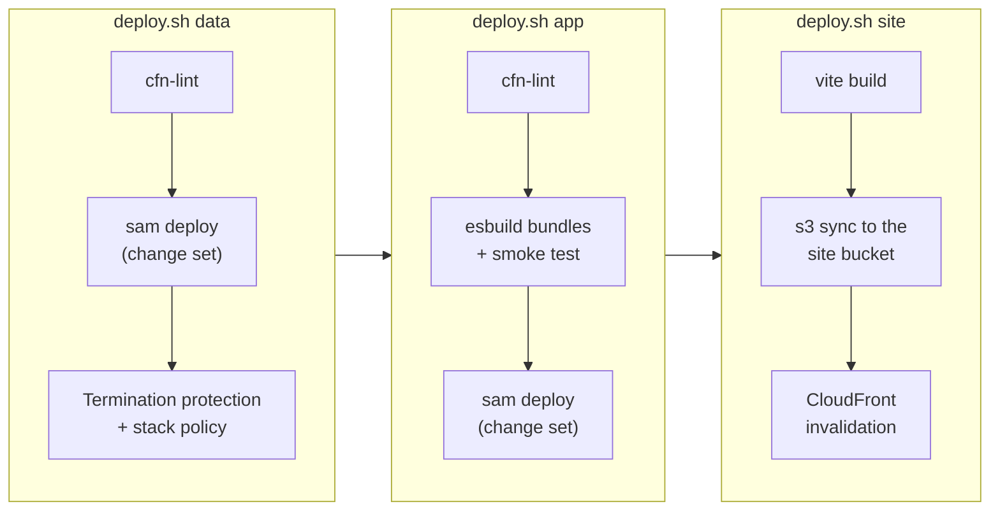

# Deployment and stacks

Everything in AWS is defined in two SAM templates (CloudFormation plus the
`AWS::Serverless` transform, which packages the Lambda code). The split between them exists for
one reason: **the guests' photos are the only thing that can't be rebuilt**, so nothing about
changing the code should ever be able to touch them.

## Two stacks per stage

Each stage (`dev`, `prod`) is two stacks, named from `aws.prefix` in `shotparty.config.json`:

| Stack                     | Contains                                                                                  | Changes       | Protection                                                              |
| ------------------------- | ----------------------------------------------------------------------------------------- | ------------- | ----------------------------------------------------------------------- |
| `<prefix>-<stage>-data`   | Media bucket, DynamoDB table, 4 SSM parameters naming them                                | Rarely        | Retain policies, termination protection, a stack policy, the change-set guard |
| `<prefix>-<stage>-app`    | CloudFront, the site bucket, the HTTP API, five Lambdas, the EventBridge rule, alarms, SNS, the kill switch | Every deploy | None needed: safe to redeploy or delete                    |

One more stack is shared by the stages: `<prefix>-account` holds the account-wide budget
([infra/account/template.yaml](../../infra/account/template.yaml); see
[Observability](observability.md#budget)). It belongs to no stage, so tearing one down never
removes it. Setup deploys it after the stages (`scripts/deploy.sh account`), and teardown deletes
it with the last stage.

### How the data stack is protected

Five independent safeguards, so no single mistake loses data:

1. **`DeletionPolicy: Retain` and `UpdateReplacePolicy: Retain`** on the bucket and the table: if
   CloudFormation ever deletes or replaces them, it leaves the real resource behind.
2. **No hard-coded names** (`BucketName`, `TableName`), so no rename can force a replacement.
3. **Termination protection** on the stack.
4. **A stack policy** that denies `Update:Replace` and `Update:Delete` on `MediaBucket` and
   `DataTable` ([stack-policy.json](../../infra/data/stack-policy.json)). CloudFormation refuses
   such an update even if someone approves the change set.
5. **Resource-level settings**: S3 versioning (a deleted object can be restored for 30 days), and
   DynamoDB point-in-time recovery and deletion protection.

The Stage 14 drill executed a change set that would have replaced the table. The stack policy
refused it, and the data was unchanged.

### How the stacks find each other

The data stack writes its resource names to SSM parameters (`/<prefix>/<stage>/mediaBucketName`,
`tableName` and their ARNs). The app stack declares them as parameters of type
`AWS::SSM::Parameter::Value<String>`, which CloudFormation resolves at deploy time
([template.yaml:20](../../infra/app/template.yaml#L20)).

CloudFormation's own `Export`/`ImportValue` would do the same job, but an exported value can't
change while another stack imports it, which locks both stacks together.

The direction matters too: the app stack depends on the data stack, never the other way around.
That's why uploads reach the validator through EventBridge rather than an S3 notification, which
would make the bucket reference the Lambda ([validation](validation.md#the-trigger)).

## What a deploy does

`scripts/deploy.sh <data|app|site|all> <stage>` ([deploy.sh](../../scripts/deploy.sh)) builds the
`sam deploy` arguments from the config and the live account (there's no `samconfig.toml`):

- **The Lambdas** are bundled one per function with esbuild and smoke-tested by importing each
  bundle the way Lambda does. They run on Node 22 on arm64 (Graviton, about 20% cheaper), with
  256 MB and a 10-second timeout (60 seconds for validate).
- **The site** syncs the built page. Hashed assets are cached for a year, `index.html` is never
  cached, and CloudFront is invalidated only if something changed
  ([deploy.sh:153](../../scripts/deploy.sh#L153)).

### Change sets and the guard

Every stack deploy creates a **change set** first: the list of resources CloudFormation will add,
modify, replace or remove.

- **Interactively**, `sam deploy --confirm-changeset` shows it and waits for a `y`. The data deploy
  reminds you to look for `Replacement: True`.
- **Unattended** (`npm run setup -- --config …`, or `SHOTPARTY_ASSUME_YES=1`), nobody reads it, so
  `scripts/changeset-guard.ts` does ([deploy.sh:47](../../scripts/deploy.sh#L47)). The change set
  is executed only if [`riskyChanges`](../../scripts/lib/changeset-guard.ts#L26) finds nothing;
  otherwise it's deleted and the deploy stops.

| Stack | The guard refuses                                                                  |
| ----- | ---------------------------------------------------------------------------------- |
| Data  | Any resource that would be removed, replaced, or *might* be replaced (`Conditional`) |
| App   | The same, but only for the CloudFront `Distribution`                               |
| Account | Nothing: its only resource is the budget, which is recreated as it was             |

The distribution is protected because a new one gets a new `*.cloudfront.net` domain, and every
printed QR code points at the old one. Everything else in the app stack can be replaced freely.

## Setup, from nothing to a working install

`npm run setup` ([setup.ts](../../scripts/setup.ts)) runs everything above in the right order, for
each stage in the config. Every step checks what already exists, so it's safe to re-run, and a
failed run is resumed by running it again.

A first install needs two passes, because the stacks depend on values that exist only after the
first pass:

- The **bucket's CORS** rule needs the site's URL, which exists only once the app stack has
  created the distribution. The first data deploy allows only local origins; the second adds the
  site.
- The **Turnstile widget** needs the site's hostname, and the app stack needs the widget's site
  key and the allowed hostnames.

Secrets are created in SSM by `scripts/bootstrap-secrets.sh` before the first app deploy, because
the app template resolves `origin_verify` and `alert_email` at deploy time.

After the stages, setup deploys the `<prefix>-account` stack with the account budget. An app stack
deployed before that stack existed holds the budget's name, so until that stage is set up again,
setup skips the account stack and says which stage to run.

### The one manual step

The CloudFront Free plan, which provides the WAF for
$0, can only be subscribed to in the console. Setup detects the plan's web ACL afterwards and passes
it to the app stack as `WebAclArn`, so later deploys keep the association instead of drifting it
away ([template.yaml:403](../../infra/app/template.yaml#L403)).

A distribution on the plan can't be deleted until the plan is canceled, so `delete-app.sh` and
`teardown` check for it and stop with instructions. Canceling the plan leaves its
`CreatedByCloudFront-…` web ACL behind, outside any stack, so both scripts delete it once the
distribution is gone.

## Deleting things

- `scripts/delete-app.sh <stage>` empties the site bucket and deletes the app stack. The photos
  and table are untouched, and the next `deploy.sh app` rebuilds everything, but with a **new
  CloudFront domain**: never do this to prod while printed cards are in use.
- `npm run teardown -- <stage>` removes the whole stage, photos included, after you type
  `destroy <stage>`. It has to lift the protections above one by one, which is the point: deleting
  the data takes a deliberate command, never a side effect. It also deletes the stage's SSM
  secrets, plus what the stages share once the other stage has no stacks left: the
  `<prefix>-account` stack (the budget) and `alert_email`. With
  `--keep-data` it runs `delete-app.sh` instead, which keeps the secrets for the next deploy.

## AWS references

- [AWS SAM templates](https://docs.aws.amazon.com/serverless-application-model/latest/developerguide/sam-specification.html)
- [Updating stacks using change sets](https://docs.aws.amazon.com/AWSCloudFormation/latest/UserGuide/using-cfn-updating-stacks-changesets.html)
- [Prevent updates to stack resources (stack policies)](https://docs.aws.amazon.com/AWSCloudFormation/latest/UserGuide/protect-stack-resources.html)
- [DeletionPolicy](https://docs.aws.amazon.com/AWSCloudFormation/latest/UserGuide/aws-attribute-deletionpolicy.html) and [UpdateReplacePolicy](https://docs.aws.amazon.com/AWSCloudFormation/latest/UserGuide/aws-attribute-updatereplacepolicy.html)
- [SSM parameter types in CloudFormation](https://docs.aws.amazon.com/AWSCloudFormation/latest/UserGuide/parameters-section-structure.html#aws-ssm-parameter-types)
