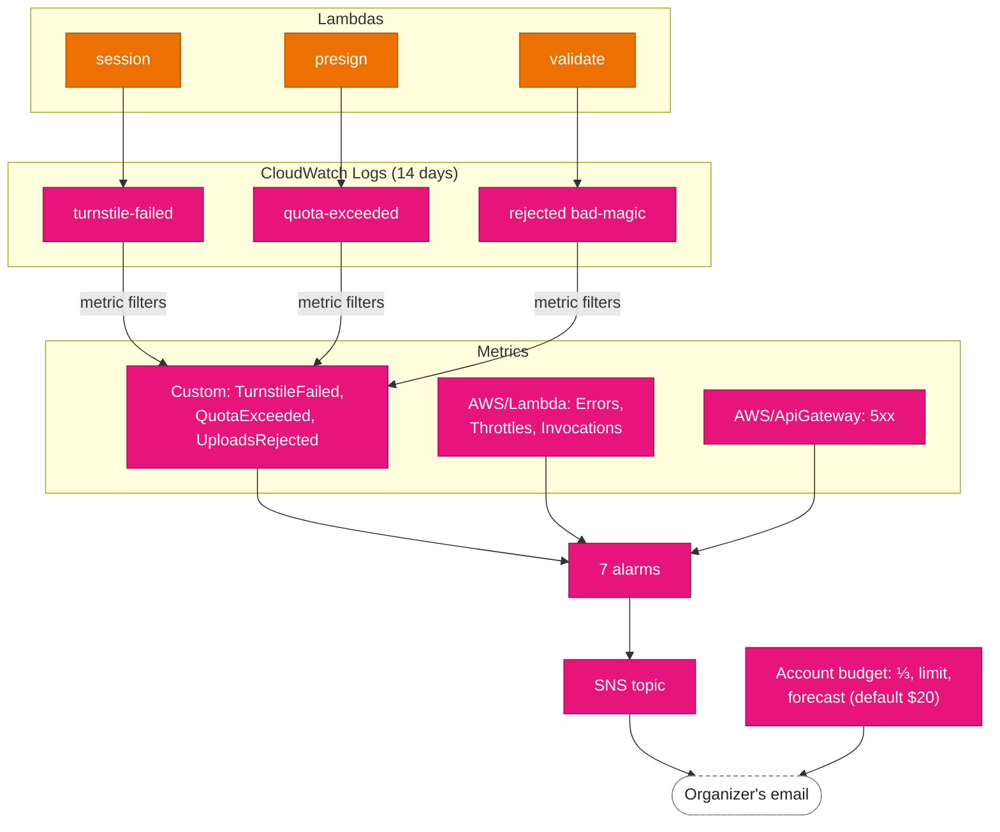

# Observability

An event lasts an evening, and the organizer isn't watching a dashboard. So the system is built to
**email when something needs attention**, and to stay quiet otherwise. Everything is CloudWatch and
SNS, defined in the app template ([template.yaml:443](../../infra/app/template.yaml#L443)),
plus a budget in its own small stack.

## Logs

Each Lambda writes to its own log group, `/aws/lambda/<prefix>-<stage>-<function>`, kept for 14
days. The groups are created by the template, so their retention is set from the start instead of
the default "never expire".

The handlers log one JSON object per line for each outcome worth counting:

| Lambda   | `result`             | Other fields                                   |
| -------- | -------------------- | ---------------------------------------------- |
| session  | `session-issued`     | `eventId`                                      |
| session  | `turnstile-failed`   | `reason`, for example `timeout-or-duplicate` or `unexpected-hostname:<host>` |
| presign  | `quota-exceeded`     | `quota` (which counter), `eventId`             |
| validate | `accepted`           | `kind`, `key`, `destKey`, `size`               |
| validate | `duplicate`          | `key`, `duplicateOf`, `size`                   |
| validate | `rejected`           | `reason: bad-magic`, `key`, `size`, `headHex`  |
| validate | `skipped`            | `reason`: `not-an-upload` or `already-processed` |

They never log tokens, sessions, PINs or IP addresses.

## Metric filters

Three log metric filters turn log lines into custom metrics in the `<prefix>/<stage>` namespace
([template.yaml:461](../../infra/app/template.yaml#L461)):

| Metric            | Log group | Pattern                    |
| ----------------- | --------- | -------------------------- |
| `TurnstileFailed` | session   | `"turnstile-failed"`       |
| `QuotaExceeded`   | presign   | `"quota-exceeded"`         |
| `UploadsRejected` | validate  | `"rejected" "bad-magic"`   |

The patterns match text terms rather than JSON fields: Lambda prefixes each line with a timestamp
and request ID, so the line as a whole isn't JSON and a `{ $.result = … }` pattern wouldn't match.

## Alarms

Seven alarms, each sending an email both when it fires and when it **recovers**, so the organizer
knows whether a problem is still going on. Missing data counts as fine, so an idle stage stays
quiet.

| Alarm                | Fires when                                                   | Usually means                                         |
| -------------------- | ------------------------------------------------------------ | ----------------------------------------------------- |
| `lambda-errors`      | Any Lambda error or timeout in 5 minutes                     | A bug, or AWS trouble; check that function's log      |
| `lambda-throttles`   | 10+ throttles across presign, session, validate in 5 minutes | A flood, or a rush bigger than reserved concurrency   |
| `api-5xx`            | 5+ API `5xx` responses in 5 minutes                          | Guests are seeing failed uploads                      |
| `presign-spike`      | More than 3,000 presigns in 5 minutes                        | A script; a real rush is about 1,000–2,000            |
| `uploads-rejected`   | 10+ rejected files in 15 minutes                             | Someone probing with non-media files                  |
| `quota-exceeded`     | 25+ quota refusals in 15 minutes                             | Abuse, or limits too low for the real guests          |
| `turnstile-failed`   | 25+ failed human checks in 15 minutes                        | A bot, or the Turnstile hostname or keys are wrong    |

The two Lambda alarms use metric math (`SUM(METRICS())`) over each function's metric, so one alarm
covers all of them ([template.yaml:494](../../infra/app/template.yaml#L494)).

## Email

Alarms publish to an SNS topic, `<prefix>-<stage>-alerts`, with one email subscription. The
address is the SSM parameter `/<prefix>/alert_email`, resolved at deploy time, so it isn't in git.
SNS sends a confirmation link first, and nothing arrives until it's clicked.

## Budget

An AWS Budget for the whole account, `<prefix>-account-monthly`, emails the same address when
actual spend passes **a third** of its limit, when it passes **the limit**, and when the month's
**forecast** passes the limit. The limit is `budgets.accountMonthlyUsd` in `shotparty.config.json`
(default **$20** a month; 0 turns it off).

Budgets cover the whole account, not a stage, so the budget lives in its own stack,
`<prefix>-account` ([template.yaml](../../infra/account/template.yaml)), which belongs to no
stage: tearing down dev never leaves prod unwatched. Setup deploys it after the stages, and
teardown deletes it with the last stage. It can't tell dev spend from prod spend; that would need
cost allocation tags, which only an Organization's management account can activate.

For scale: the whole account spent $0.002 through the build, every test suite and a 300-upload
load test. A live event is expected at $0.50–$2 a month.

## Health check

`GET /api/health` answers `200` with the stage, the media bucket's name and the time, without
touching DynamoDB or SSM ([health.ts](../../api/src/lib/health.ts)). It's the one API route that
doesn't require the origin secret, so monitoring can call it directly. `npm run setup` and the
abuse tests use it.

## What it costs

Logs, metric filters, SNS email and one budget are free at this volume. CloudWatch alarms are the
one recurring cost. They're billed per metric they read, and a metric-math alarm counts each
metric in its expression: one stage's alarms read 13 (5 + 3 for the two Lambda alarms, 1 each for
the other five). The free tier covers 10 per account, and each one beyond costs $0.10 a month.
That's the largest part of an idle install's bill, about $0.50 a month in this project's account.

## AWS references

- [CloudWatch Logs metric filters](https://docs.aws.amazon.com/AmazonCloudWatch/latest/logs/MonitoringLogData.html)
- [Filter pattern syntax](https://docs.aws.amazon.com/AmazonCloudWatch/latest/logs/FilterAndPatternSyntax.html)
- [Alarms on metric math expressions](https://docs.aws.amazon.com/AmazonCloudWatch/latest/monitoring/Create-alarm-on-metric-math-expression.html)
- [Amazon SNS email notifications](https://docs.aws.amazon.com/sns/latest/dg/sns-email-notifications.html)
- [AWS Budgets](https://docs.aws.amazon.com/cost-management/latest/userguide/budgets-managing-costs.html)
