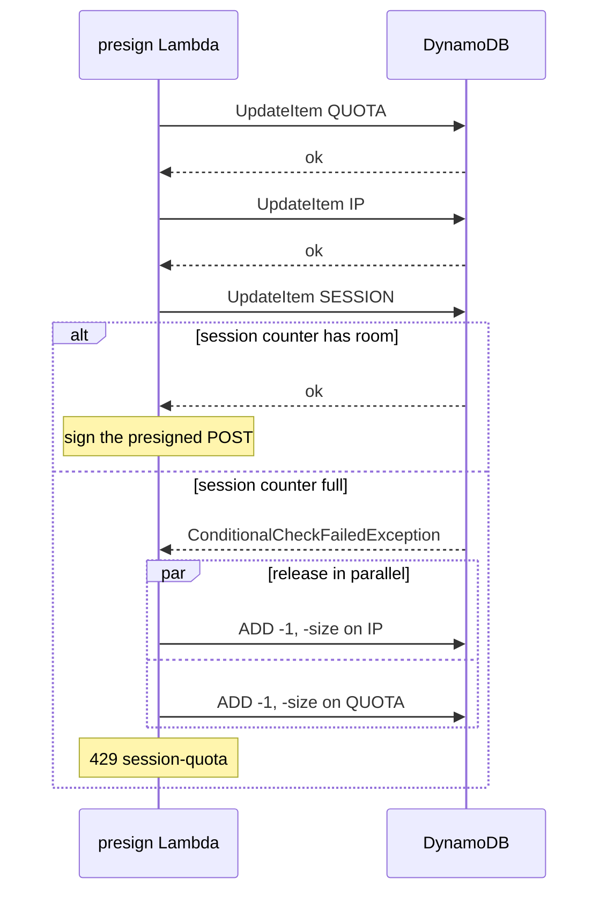
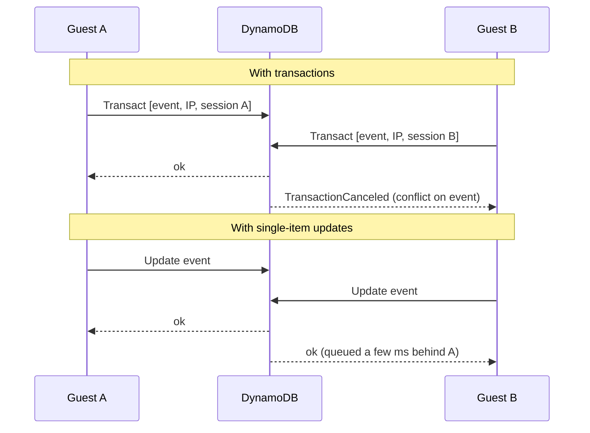

# Quotas

Quotas are what keep a public upload link from becoming a bill. Before the presign Lambda signs an
upload link, it reserves room for the file in three counters in DynamoDB. If any of them is full,
the guest gets a `429` and no link. The code is [quota.ts](../../api/src/lib/quota.ts).

## The limits

[`QuotaLimits`](../../api/src/lib/quota.ts#L17) has five numbers:

| Limit            | Default | Scope                                  | Why                                                       |
| ---------------- | ------- | -------------------------------------- | --------------------------------------------------------- |
| `sessionFiles`   | 500     | One guest session (12 hours)           | One person, or one Turnstile pass, can't fill the album   |
| `sessionBytes`   | 10 GiB  | One guest session                      | Same, for a guest with long videos or RAW photos          |
| `ipFilesPerHour` | 3,000   | One network, per clock hour (UTC)      | Many sessions from one machine still meet a ceiling       |
| `eventFiles`     | 20,000  | The whole event, for its lifetime      | The hard bound on storage, whatever else fails            |
| `eventBytes`     | 100 GiB | The whole event                        | Same, in bytes: about $2.30 a month in S3 Standard        |

The IP limit is high on purpose. A venue's Wi-Fi puts every guest behind one public address, so a
limit sized for one person would lock out the whole room.

The limits come from three places, later ones winning
([effectiveLimits](../../api/src/lib/events.ts#L84)):

1. **Built-in defaults**: `DEFAULT_LIMITS` ([quota.ts:27](../../api/src/lib/quota.ts#L27)).
2. **The install's defaults**: `uploads.sessionFiles` and `uploads.sessionGb` in
   `shotparty.config.json`. Setup passes them to the app stack, which sets them as environment
   variables on the presign Lambda ([upload-limits.ts:16](../../api/src/lib/upload-limits.ts#L16)).
   A malformed value fails the Lambda when it starts, not silently.
3. **Per event**: `npm run event:create` and `npm run event:update` take `--session-files`,
   `--session-gb`, `--ip-files-per-hour`, `--event-files` and `--event-gb`. They're stored on the
   event's item as `limit_<name>` attributes ([events.ts:195](../../api/src/lib/events.ts#L195)).

## The counters

Each counter is one DynamoDB item with two numbers, `files` and `bytes`:

| Counter | Partition key (`pk`)    | Sort key (`sk`)            | Limits checked                       | Expires (`ttl`)                    |
| ------- | ----------------------- | -------------------------- | ------------------------------------ | ---------------------------------- |
| Event   | `QUOTA#<eventId>`       | `TOTAL`                    | `eventFiles`, `eventBytes`           | Never                              |
| IP-hour | `IP#<ipHash>`           | `HOUR#2026-10-10T20`       | `ipFilesPerHour` (bytes kept, not checked) | 2 hours after its first write |
| Session | `SESSION#<sessionId>`   | `QUOTA`                    | `sessionFiles`, `sessionBytes`       | When the session expires           |

The session counter shares its partition with the session record (`SESSION#<id>` / `META`), and
both disappear when the session expires. The IP-hour counter starts fresh every UTC hour, because
the hour is part of its key; the TTL just clears old ones out.

DynamoDB TTL deletes expired items in the background, usually within a few days, but they no longer
matter once their session or hour is over.

### IP buckets and hashing

The address comes from CloudFront's `x-viewer-ip`, trusted only with the origin secret
([client-ip.ts:18](../../api/src/lib/client-ip.ts#L18)). Two things happen before it's used as a key:

- **Bucketing** ([client-ip.ts:37](../../api/src/lib/client-ip.ts#L37)): an IPv4 address is used as
  is, but an IPv6 address is cut to its `/64` network. One home or phone usually owns a whole
  `/64`, so a per-address limit would be trivial to dodge on IPv6.
- **Hashing** ([quota.ts:40](../../api/src/lib/quota.ts#L40)): the bucket is HMAC-SHA256'd with the
  stage's session key and cut to 22 base64url characters (132 bits). The table never stores an IP
  address, and without the key the hashes can't be reversed by trying every IPv4 address.

## One reservation

Each counter update is a single-item conditional `UpdateItem`
([reservationUpdates](../../api/src/lib/quota.ts#L70)). For a counter with a byte limit:

```text
UpdateExpression:    ADD files :one, bytes :size  SET #ttl = if_not_exists(#ttl, :ttl)
ConditionExpression: attribute_not_exists(files) OR (files < :maxFiles AND bytes <= :room)

:room = maxBytes - size
```

- `ADD` creates the item and its attributes the first time, and increments them after that.
- The condition is checked **before** the write, atomically for that item. It's written as
  `bytes <= maxBytes - size` because condition expressions can't do arithmetic.
- The IP counter has no byte limit, so its condition is just `files < :maxFiles`.
- The event counter has no `SET #ttl` part, because it never expires.
- A full counter fails the condition with `ConditionalCheckFailedException`, and nothing is written.

A file bigger than the session or event byte limit could never fit, so it's refused before any
write ([quota.ts:71](../../api/src/lib/quota.ts#L71)).

### Reserve and roll back

[`reserveQuota`](../../api/src/lib/quota.ts#L155) applies the three updates in order: the
**event**, then the **IP-hour**, then the **session**. If one is full, it releases the ones already
made, with an unconditional `ADD files -1, bytes -size`, and returns that counter's error:



The shared counters go first so that a full event or a full network refuses the request without
touching the guest's own counter. The releases run in parallel and are best effort: an error in one
doesn't stop the others. Any error other than a full counter is rethrown after the same rollback,
and the guest sees a `500` that the page retries.

## Why not a transaction

The obvious design is one `TransactWriteItems` with the three conditional updates: all three
commit or none do. That design passes every unit and abuse test.

Under load, it breaks down. A load test of 20 simulated guests uploading 10 files each, all at once,
failed 32 of 200 presigns with `TransactionConflict`. DynamoDB **cancels** a transaction when
another one is writing the same item at the same time. Every guest at an event shares the event
counter, and usually the IP counter too, so the busiest moment of an event is exactly when
transactions would fail most.



Single-item writes to the same key are **serialized** rather than canceled: the second one waits a
few milliseconds and succeeds. With single-item updates, the same kind of load test passed 300 out
of 300 with a median presign time of 0.5 seconds. Single-item writes also cost half as much, since
transactional writes are billed double. The decision is recorded in
[ADR 0003](../adr/0003-no-dynamodb-transactions.md).

## Consistency

The trade is that the three counters are no longer atomic together. What can go wrong, and why
it's acceptable:

- **A brief over-count.** Between an increment and its rollback, another request can see a counter
  slightly higher than its real value and be refused. That only happens when a counter is within a
  few files of its limit, and it errs toward refusing.
- **A lost rollback.** If the Lambda dies between an increment and its release, that counter stays
  one file too high. Session and IP counters expire; the event counter's limit has a wide margin.
- **Presigns, not uploads.** A reservation is made when the link is signed. A guest who abandons an
  upload, or whose upload is retried with a new link, uses quota that holds no file. The limits are
  sized with that headroom, and a duplicate dropped by the validator still counts.

Each counter on its own is exact: the condition and the increment are one atomic operation, so
concurrent guests can never push a counter past its limit.

## When a quota is full

The presign Lambda answers `429` with the counter's name as the error, and logs a
`quota-exceeded` line ([presign.ts:81](../../api/src/handlers/presign.ts#L81)):

| Error           | The guest sees                                         |
| --------------- | ------------------------------------------------------ |
| `session-quota` | "upload limit reached for this phone"                  |
| `ip-rate-limit` | "too many uploads from this network, try again in an hour" |
| `event-quota`   | "the album is full"                                    |

The page doesn't retry these ([upload.ts:76](../../web/src/upload.ts#L76)): a quota won't free up
within the retry backoff. It still retries a plain `429` from API Gateway's throttle, which has no
error code.

A log metric filter counts the `quota-exceeded` lines, and an alarm emails the organizer when 25 or
more happen within 15 minutes ([template.yaml:705](../../infra/app/template.yaml#L705)). That's
either abuse, or limits set too low for the real guests; `event:update` can raise them without a
deploy.

## AWS references

- [DynamoDB update expressions: ADD](https://docs.aws.amazon.com/amazondynamodb/latest/developerguide/Expressions.UpdateExpressions.html#Expressions.UpdateExpressions.ADD)
- [Condition expressions](https://docs.aws.amazon.com/amazondynamodb/latest/developerguide/Expressions.ConditionExpressions.html)
- [Transaction conflict handling](https://docs.aws.amazon.com/amazondynamodb/latest/developerguide/transaction-apis.html#transaction-conflict-handling)
- [Time to Live](https://docs.aws.amazon.com/amazondynamodb/latest/developerguide/TTL.html)
