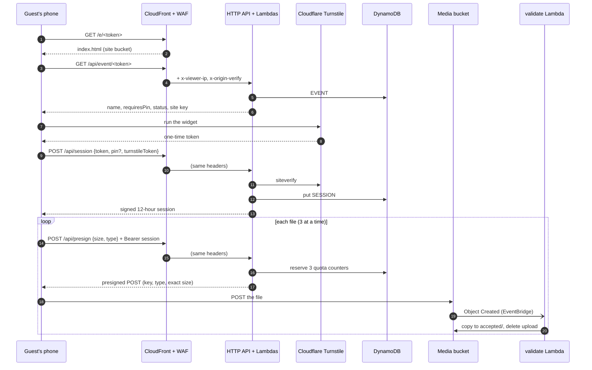

# Request flow

This page follows one guest from scanning the QR code to a photo sitting in `accepted/`. Each step
names the AWS resources it touches; the later pages go deeper into each one.

## The whole path

## 1. The page

The QR code holds `https://<distribution>.cloudfront.net/e/<token>`, where the token is 128 random
bits ([events.ts:98](../../api/src/lib/events.ts#L98)).

- **CloudFront** serves the page from the **site bucket**, which is private and readable only by
  this distribution through Origin Access Control
  ([template.yaml:327](../../infra/app/template.yaml#L327)).
- `/e/<token>` isn't a file. A CloudFront Function on the default behavior rewrites any `/e/…`
  path to `/index.html` ([template.yaml:365](../../infra/app/template.yaml#L365)). This is a
  viewer-request function rather than a custom error page, because an error-page rule would also
  rewrite real `403`/`404` answers from the API.
- The page's assets have hashed names and are cached for a year; `index.html` is uploaded with
  `no-cache`, so a redeploy shows up on the next load ([deploy.sh:122](../../scripts/deploy.sh#L122)).

## 2. The event lookup

The page reads the token from the path and calls `GET /api/event/{token}`
([main.ts:67](../../web/src/main.ts#L67)).

- Every `/api/*` request goes through a second CloudFront behavior with caching disabled. Its
  viewer-request function stamps two headers, `x-viewer-ip` (the guest's real address) and
  `x-origin-verify` (a shared secret), overwriting anything the guest sent
  ([template.yaml:386](../../infra/app/template.yaml#L386)).
- **API Gateway** (an HTTP API, throttled to 50 requests per second with a burst of 100 per route)
  invokes the **event** Lambda ([event.ts:11](../../api/src/handlers/event.ts#L11)).
- The Lambda first refuses anything without the right `x-origin-verify` (see
  [abuse protection](abuse-protection.md#the-origin-check)), checks the token's shape, then reads
  `EVENT#<token>` from **DynamoDB**.
- It answers with what the page needs to draw itself: the event's name and text, whether a PIN is
  required, whether uploads are open, the kill switch's state and the public Turnstile site key.
  It never returns the PIN hash or the quotas.

The page then shows the event, or a friendly "not open yet", "closed" or "paused" message.

## 3. The session

Nothing happens until the guest picks files. Then the page needs an upload session
([session.ts:35](../../web/src/session.ts#L35)):

1. It runs the **Turnstile** widget, invisible for most guests, and gets a one-time token.
2. It sends `POST /api/session` with the event token, the token from Turnstile and the PIN if the
   event has one.
3. The **session** Lambda verifies the Turnstile token with Cloudflare, then runs the gate (kill
   switch, token, window, PIN), then signs a 12-hour session and stores it as `SESSION#<id>`
   ([session.ts:16](../../api/src/handlers/session.ts#L16)).

The page keeps the session in `localStorage`, so a guest who comes back later the same evening
doesn't pass Turnstile again. The details are in [sessions and the gate](sessions-and-gate.md).

## 4. One upload link per file

The page uploads three files at a time ([main.ts:108](../../web/src/main.ts#L108)). For each one
it calls `POST /api/presign` with the file's size and content type, and the session as a Bearer
token. The **presign** Lambda ([presign.ts:29](../../api/src/handlers/presign.ts#L29)):

1. checks the origin header;
2. checks the session's signature and expiry (no database read), then that its record still exists;
3. validates the request: an allow-listed content type, a whole number of bytes up to the per-file
   cap (1 GiB by default), an optional guest name of up to 80 characters;
4. runs the gate again: the kill switch and the window may have changed since the session was issued;
5. reserves room in three [quota](quotas.md) counters, or answers `429`;
6. returns an S3 presigned POST for a key the server chose, pinned to the content type and the
   **exact** size, valid for 10 minutes ([presign and S3](presign-and-s3.md)).

## 5. Straight to S3

The browser posts the file directly to the **media bucket**, with XHR so it can show progress
([upload.ts:227](../../web/src/upload.ts#L227)). No file bytes pass through Lambda or API Gateway,
so their payload limits and per-byte costs never apply.

The bucket checks the policy itself: a body of any other size, another content type, another key
or an expired link is refused. Its CORS rule allows `POST` only from the site's origin
([data template.yaml:82](../../infra/data/template.yaml#L82)).

The file lands at `uploads/<eventId>/<guest-slug>/<uuid>.<ext>`.

## 6. Validation

The media bucket sends its object events to **EventBridge**. A rule in the app stack matches
`Object Created` under `uploads/` and invokes the **validate** Lambda, retrying for up to an hour
([template.yaml:277](../../infra/app/template.yaml#L277)).

The validator reads the first 64 bytes. Real photos and videos are copied to
`accepted/<eventId>/<guest-slug>/<uuid>.<ext>` and the upload is deleted; anything else is deleted
and recorded. A guest's second copy of the same file is dropped. See
[post-upload validation](validation.md).

The organizer's tools (the gallery and `npm run download`) read only `accepted/`.

## When something fails

The page retries what can succeed on a second try and shows everything else next to the file
([upload.ts:84](../../web/src/upload.ts#L84)):

| Failure                                                        | What the page does                              |
| -------------------------------------------------------------- | ----------------------------------------------- |
| Network error, timeout, `5xx`, `429` from API throttling       | Retries after 1 s, 3 s and 9 s                  |
| Uploads paused by the kill switch (`503`)                      | Retried like any `5xx`, then shows "paused"     |
| Turnstile refused (`403 verification-failed`)                  | Retries with a new check                        |
| Session expired or revoked (`401`)                             | Forgets the session; the retry gets a new one   |
| Presigned link expired before the upload started               | Retries with a new link                         |
| Quota full (`429` with `session-quota`, `ip-rate-limit`, `event-quota`) | Fails at once with a message: it won't free up within the backoff |
| Wrong or missing PIN (`403`)                                   | Fails and opens the PIN field                   |
| Event closed, not open yet (`403`) or unknown (`404`)          | Fails with a message                            |
