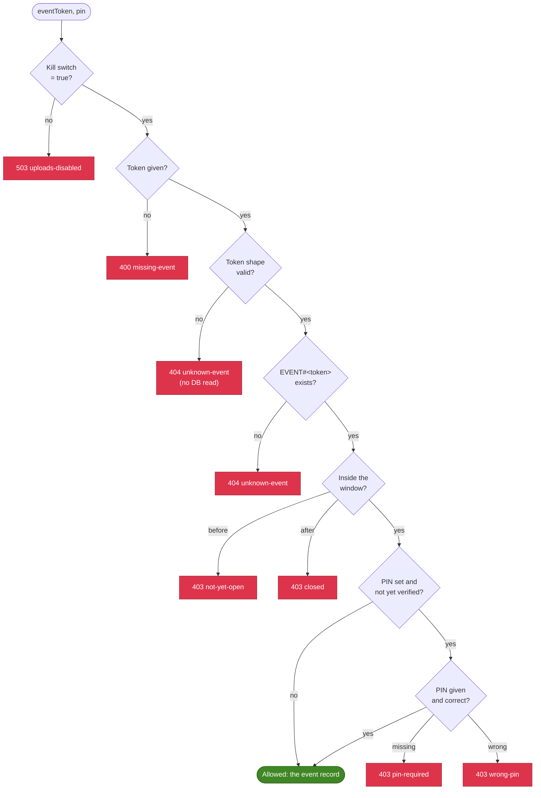

# Sessions and the gate

Two questions are asked before any upload link is signed:

- **The gate:** may anyone upload to this event right now? It checks the kill switch, the event
  token, the upload window and the PIN.
- **The session:** is this request from a guest who passed a human check? It checks a signed
  token issued after Turnstile.

The session Lambda asks both once. The presign Lambda asks both again for every file.

## The gate

[`checkUploadAllowed`](../../api/src/lib/gate.ts#L30) runs its checks cheapest first and stops at
the first refusal. Each refusal's `kind` is also the API's error code
([gateErrorStatus](../../api/src/lib/gate.ts#L56)):



### Event token

Each event is reached through a token in its link: 16 random bytes (128 bits), base64url-encoded
([events.ts:98](../../api/src/lib/events.ts#L98)). It's the event's secret: it is the partition
key `EVENT#<token>` and is never used in S3 keys, which use the public `eventId` instead
(for example `summer-party-2026`).

Anything that doesn't match `^[A-Za-z0-9_-]{16,64}$` can't be a real token, so it gets the same
`404` as an unknown one without a database read ([events.ts:95](../../api/src/lib/events.ts#L95)).

### Window

`openFrom` and `openUntil` are ISO 8601 timestamps on the event record. The gate compares them
with the Lambda's clock ([events.ts:131](../../api/src/lib/events.ts#L131)). The event lookup
returns the same status, so the page can say "not open yet" or "closed" before the guest picks a
file.

### Kill switch

The SSM parameter `/<prefix>/<stage>/uploads_enabled` stops every upload in the stage. It **fails
closed**: any value except `true` (or a missing value) means disabled
([gate-deps.ts:26](../../api/src/lib/gate-deps.ts#L26)). `scripts/uploads.sh <stage> off` flips
it and waits until every Lambda has seen the change.

The template creates it as `true`. CloudFormation rewrites the value only when the template's own
value changes, so a manual `false` survives unrelated redeploys
([template.yaml:220](../../infra/app/template.yaml#L220)).

### PIN

An event can require a PIN, printed on the card next to the QR code but not inside it, so a photo
of the QR code alone isn't enough. Events have no PIN by default; `event:create --generate-pin`
makes a random 6-digit one, and `--pin <pin>` sets your own.

- **Stored** as `scrypt$<salt>$<hash>`: a 16-byte random salt and a 32-byte scrypt hash
  ([events.ts:110](../../api/src/lib/events.ts#L110)). The plain PIN is never stored.
- **Normalized** before hashing: spaces and dashes are removed and letters uppercased, because
  guests type it on a phone.
- **Compared** in constant time, after rejecting anything longer than 32 characters
  ([events.ts:116](../../api/src/lib/events.ts#L116)).
- **Checked once**, when the session is issued. Presign calls the gate with
  `pinAlreadyVerified: true`.

A 6-digit PIN has a million values; what makes guessing impractical is that each guess needs a new
Turnstile pass (below).

## Turnstile

[Cloudflare Turnstile](https://developers.cloudflare.com/turnstile/) is a free human check. The
page renders the widget only when it needs a session, in `interaction-only` mode: most guests see
nothing, and a few get a checkbox ([turnstile.ts:57](../../web/src/turnstile.ts#L57)).

The widget's token proves nothing until the server checks it with Cloudflare.
[`verifyTurnstile`](../../api/src/lib/turnstile.ts#L75) posts it to `siteverify` with the secret
key and the guest's real IP, then requires:

- `success: true`. Cloudflare refuses tokens that are expired (5 minutes) or already used.
- a **hostname** on the configured list (`TurnstileHostnames`: the stage's CloudFront domain), so
  a token from someone else's page with the same site key is useless;
- the **action** `upload-session`, which the page's widget declares.

The hostname and action checks are skipped only when no hostnames are configured, which is how
Cloudflare's always-pass test keys are used locally.

A failure answers `403 verification-failed` and logs `turnstile-failed` with the reason, which
feeds an alarm. If Cloudflare can't be reached, the session is refused: no verdict means no session.

**Turnstile runs before the gate** ([session.ts:31](../../api/src/handlers/session.ts#L31)). That
order is the point: a script trying PINs has to solve a human check per guess.

## The session

Once Turnstile and the gate pass, the session Lambda issues a token
([session.ts:27](../../api/src/lib/session.ts#L27)):

```text
v1.<id>.<expires>.<signature>

v1           format version
<id>         16 random bytes, base64url (22 characters)
<expires>    epoch seconds, 12 hours from now
<signature>  HMAC-SHA256 over "v1.<id>.<expires>", base64url
```

The HMAC key is the SSM SecureString `/<prefix>/<stage>/session_key`, generated by
`scripts/bootstrap-secrets.sh` and never in git.

The session is also stored as `SESSION#<id>` / `META` with the event's token and ID, its creation
time and a `ttl` equal to its expiry ([session.ts:88](../../api/src/lib/session.ts#L88)). The write
is conditional on the key not existing, so an ID can't be reused.

### Checking a session

Presign checks a session in two steps ([presign.ts:37](../../api/src/handlers/presign.ts#L37)):

1. **The signature and expiry, with no I/O** beyond the cached key
   ([session.ts:43](../../api/src/lib/session.ts#L43)). It refuses tokens over 256 characters, the
   wrong number of parts, a malformed ID or expiry, a signature that differs (compared in constant
   time) and an expiry in the past. Forged and tampered tokens never reach DynamoDB.
2. **The stored record** ([session-store.ts:22](../../api/src/lib/session-store.ts#L22)). It must
   still exist, and it says which event the session belongs to. The event comes from the record,
   not from the request, so a session for one event can't upload to another.

| Refusal                            | Status | Code               |
| ---------------------------------- | ------ | ------------------ |
| No `Authorization` header          | 401    | `session-required` |
| Bad format or signature, no record | 401    | `invalid-session`  |
| Past its expiry                    | 401    | `session-expired`  |

The page treats all three the same way: it forgets the session, and the retry gets a new one.

### On the page

The page keeps the session in `localStorage` under `shotparty.session.<token>`
([session.ts:67](../../web/src/session.ts#L67)), so a reload or a second visit that evening skips
Turnstile. It requests a new one 5 minutes before expiry. Concurrent uploads that all need a
session share one request.

A side effect: once a guest has a session, a PIN typed later isn't sent again, because the PIN
was checked when the session was issued.

### Revoking sessions

- **One session:** delete its `SESSION#<id>` item. Presign refuses it once the cached copy expires,
  within 30 seconds.
- **Every session in a stage:** `scripts/bootstrap-secrets.sh <stage> --rotate-session-key`. Old
  signatures stop verifying once each Lambda reloads the key, within 5 minutes.
- **Every upload, now:** the kill switch.

## Caching

Lambda containers are reused between requests, so lookups are cached per container in memory with
a small TTL cache ([gate.ts:78](../../api/src/lib/gate.ts#L78)). This keeps most requests to one
DynamoDB read or none.

| Value                                 | Cached for | So a change takes effect within      |
| ------------------------------------- | ---------- | ------------------------------------ |
| Kill switch                           | 30 s       | 30 s (`uploads.sh` waits 35 s)       |
| Event record (`EVENT#<token>`)        | 30 s       | 30 s after `event:update` or `event:close` |
| Session record                        | 30 s       | 30 s after deleting it               |
| Secrets: session key, Turnstile secret, origin secret | 5 min | 5 min after rotating them |

The cache is per container, so different Lambdas, and different containers of the same Lambda,
see a change at different moments within that window.

The origin secret is also built into the CloudFront Function when the app stack deploys, so after
rotating it, redeploy the app stack.

## AWS references

- [SSM Parameter Store SecureString parameters](https://docs.aws.amazon.com/systems-manager/latest/userguide/sysman-paramstore-securestring.html)
- [DynamoDB condition expressions](https://docs.aws.amazon.com/amazondynamodb/latest/developerguide/Expressions.ConditionExpressions.html)
- [DynamoDB Time to Live](https://docs.aws.amazon.com/amazondynamodb/latest/developerguide/TTL.html)
- [Lambda execution environment reuse](https://docs.aws.amazon.com/lambda/latest/dg/lambda-runtime-environment.html)
