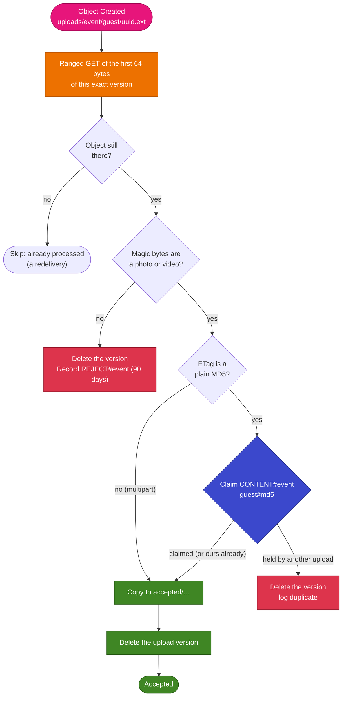

# Post-upload validation

The presigned POST pins the size and content type, but the content type is only what the browser
*declared*. Nothing stops a zip file renamed `.jpg`. So every upload lands in a holding area,
`uploads/`, and a Lambda checks what it really is before it joins the event's photos in
`accepted/`. The same step drops a guest's second copy of a file they already uploaded.

## The trigger

The media bucket (data stack) sends its object events to **Amazon EventBridge**
(`EventBridgeEnabled: true`, [data template.yaml:91](../../infra/data/template.yaml#L91)). A rule
in the app stack matches them and invokes the **validate** Lambda
([template.yaml:277](../../infra/app/template.yaml#L277)):

```yaml
source: [aws.s3]
detail-type: [Object Created]
detail:
  bucket: { name: [<media bucket>] }
  object: { key: [{ prefix: uploads/ }] }
```

Why EventBridge rather than a classic S3 → Lambda notification: the notification would be a
property of the bucket pointing at the Lambda, so the data stack would depend on the app stack,
which [must stay deletable](deployment.md). With EventBridge, the bucket only says "send events",
and the app stack owns the rule.

EventBridge delivers **at least once** and retries a failed invocation up to 8 times over an hour.
The Lambda has a 60-second timeout, for a server-side copy of a file up to 1 GiB, and at most 50
run at once.

## What the validator does

[`validateUpload`](../../api/src/lib/validate-upload.ts#L88), wired to S3 and DynamoDB in
[validate.ts](../../api/src/handlers/validate.ts):



- The key arrives URL-encoded (`+` for a space), as in classic S3 notifications, and is decoded
  first ([validate.ts:30](../../api/src/handlers/validate.ts#L30)).
- Every read, copy and delete names the event's **version ID**, so the validator acts on exactly
  the object that triggered it.
- "Delete" removes that version permanently, not with a delete marker, so nothing is left to expire.

## Magic bytes

[`sniffMedia`](../../api/src/lib/magic.ts#L102) decides from the file's signature alone:

| Format                         | Signature                                                                 |
| ------------------------------ | ------------------------------------------------------------------------- |
| JPEG                           | `FF D8 FF`                                                                |
| PNG                            | `89 50 4E 47 0D 0A 1A 0A`                                                 |
| GIF                            | `GIF87a` or `GIF89a`                                                      |
| WebP                           | `RIFF` …`WEBP`                                                            |
| WebM                           | EBML header `1A 45 DF A3` with the `webm` doc type (other Matroska is refused) |
| HEIC/HEIF, MP4, MOV, 3GP, CR3  | An ISO-BMFF `ftyp` box, decided by its **major brand** (below)            |
| Older QuickTime                | A first atom of `moov`, `mdat`, `wide`, `free`, `skip` or `pnot`          |
| DNG, CR2, NEF, ARW (and TIFF)  | TIFF header `II*\0` or `MM\0*`                                            |
| ORF                            | `IIRO`, `IIRS` or `MMOR`                                                  |
| RW2                            | `IIU\0`                                                                   |
| RAF                            | `FUJIFILMCCD-RAW`                                                         |

ISO-BMFF files are decided by the **major** brand in the `ftyp` box
([magic.ts:67](../../api/src/lib/magic.ts#L67)): `heic`/`heix`/`hevc`/… for HEIC, `isom`/`mp42`/…
for MP4, `qt  ` for QuickTime, `3gp*` for 3GP and `crx ` for Canon CR3. The generic HEIF brands
`mif1` and `msf1` pass only if a HEIC brand is also listed. Matching on compatible brands alone
would admit AVIF images (which also list `mif1`) and M4A audio, which aren't on the allow-list.

Plain TIFF passes, because DNG, CR2, NEF and ARW all share its header; that's harmless.

The validator doesn't compare the detected format with the declared content type: any real photo
or video is kept. It's there to stop files that aren't media at all.

## Accepted

The object is copied to `accepted/` under the same path
([acceptedKey](../../api/src/lib/validate-upload.ts#L74)), keeping its content type and metadata,
then the upload version is deleted. Of the app's roles, only the validator's can write to
`accepted/`.

If the Lambda stops between the copy and the delete, EventBridge redelivers the event: the upload
is still there, the claim is already its own, and the copy simply runs again.

## Rejected

Anything else is deleted and recorded as `REJECT#<eventId>` / `<time>#<key>` with the guest folder,
the size and the first 16 bytes in hex, kept for 90 days
([validate.ts:103](../../api/src/handlers/validate.ts#L103)). The log line
`{"result":"rejected","reason":"bad-magic",…}` feeds an alarm at 10 rejections in 15 minutes.

The guest's page has already shown the upload as done at that point; it doesn't learn about the
rejection. The organizer does.

## Duplicates

A guest who picks the same photo twice shouldn't store it twice or spend quota on it. Two
independent checks catch that, both **per guest**: the same photo from two different guests keeps
both copies.

**On the page** ([uploaded.ts](../../web/src/uploaded.ts)). Each picked file is fingerprinted by
its size plus a SHA-256 of its first and last MiB (hashing a whole 1 GiB video isn't practical on a
phone). After a successful upload, the fingerprint is remembered in `localStorage` per event and
guest name, up to 5,000 entries. A repeat, from earlier or within the same pick, is shown as
"already uploaded" and never sent, so it costs no quota.

**In the validator**, for what the page can't see (another browser, cleared storage, a script).
For a single-part upload to an SSE-S3 bucket, the ETag is the file's MD5. Before copying, the
validator claims the content with a conditional write ([validate.ts:63](../../api/src/handlers/validate.ts#L63)):

```text
PutItem   pk = CONTENT#<eventId>   sk = <guest>#<md5>   destKey = accepted/…
Condition attribute_not_exists(pk) OR destKey = :destKey
```

- **Nobody holds it:** the claim succeeds and the file is accepted.
- **This same upload holds it** (a redelivery): the condition still passes, and processing goes on.
- **Another upload holds it:** the write fails, DynamoDB returns the old item
  (`ReturnValuesOnConditionCheckFailure: ALL_OLD`), and the new upload is deleted. The log line
  names the copy that was kept.

The claim is made **before** the copy, so two identical uploads racing each other keep exactly one.
An ETag that isn't a plain MD5 (a multipart upload's ends in `-<parts>`) is accepted without a
claim and logged as `no-md5-etag`; guest uploads are always single-part.

"Per guest" means per guest folder: guests who leave the name blank all share `anonymous`. A
duplicate dropped here was still counted by the quota at presign time.

## Recovering stranded uploads

If the validator was down for longer than EventBridge's hour of retries, files stay in `uploads/`.
`scripts/reprocess-uploads.sh <stage>` invokes the validator for each one, with the same result as
the original event.

## Related

- [ADR 0004: Validate uploads by their magic bytes](../adr/0004-magic-byte-validation.md)
- [Data model](data-model.md) for the `CONTENT#` and `REJECT#` items.

## AWS references

- [Amazon S3 events with EventBridge](https://docs.aws.amazon.com/AmazonS3/latest/userguide/EventBridge.html)
- [EventBridge retry policy](https://docs.aws.amazon.com/eventbridge/latest/userguide/eb-rule-retry-policy.html)
- [S3 object ETags and checksums](https://docs.aws.amazon.com/AmazonS3/latest/userguide/checking-object-integrity.html)
- [Deleting object versions](https://docs.aws.amazon.com/AmazonS3/latest/userguide/DeletingObjectVersions.html)
